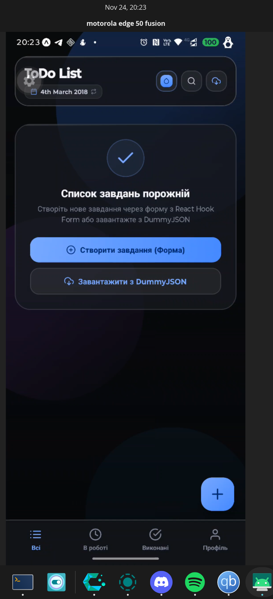
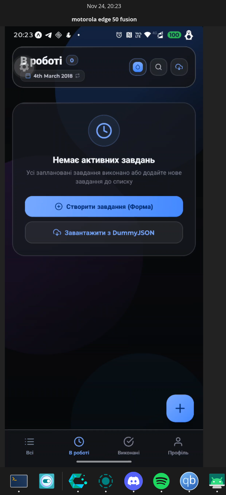
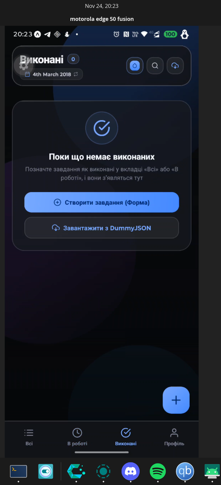
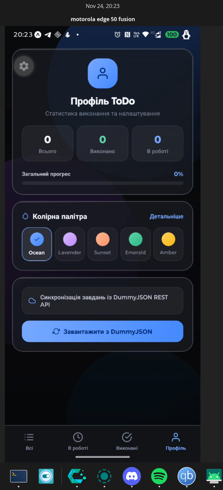

# ToDo List — React Native (Expo Go)

Додаток списку завдань (**ToDo List**), розроблений на React Native з повною підтримкою **Expo Go**. Реалізовано функціонал домашніх завдань з роботи зі списками (`02_rn_list.pdf`) та формами (`03_rn_todo_forms.pdf`).

---

## 📸 Скріншоти застосунку / Screenshots

<p align="center">
  
  
  
  
</p>

---

## 📝 Реалізація форми завдань (ДЗ 3 — Forms)

Відповідно до вимог файлу `03_rn_todo_forms.pdf`:
- **React Hook Form**: Форма повністю побудована з використанням хуків `useForm` та компонентів `Controller` для контрольованого керування станом інпутів.
- **Поля форми**:
  - ✏️ **Назва завдання (`title`)**: обов'язкове текстове поле з валідацією мінімальної довжини (від 3 символів) та повідомленнями про помилки.
  - 📅 **Дата виконання (`date`)**: поле введення з підтримкою швидких кнопок-пресетів (*«Сьогодні»*, *«Завтра»*, *«+2 дні»*).
  - ⚡ **Пріоритет (`priority`)**: вибір одного з трьох рівнів:
    - `high` (Високий)
    - `medium` (Середній)
    - `low` (Низький)
  - 🔘 **Статус завдання (`status`)**: перемикач між `to-do` та `done`, який **за замовчуванням встановлюється на `to-do`**.

---

## 📱 Основні можливості (ДЗ 2 — Lists & UI)

- **Оптимізований список**: Використано офіційний компонент `FlatList` з `keyExtractor` та підтримкою `pull-to-refresh` (оновлення списку свайпом).
- **Синхронізація з REST API**: Інтеграція з [DummyJSON Todos API](https://dummyjson.com/docs/todos#todos-all) (завантаження, оновлення статусу, додавання та видалення).
- **Інтерактивність**:
  - Натискання на завдання перемикає статус (`done` ⟷ `to-do`) з анімацією та тактильним відгуком (Haptics).
  - Видалення окремих завдань або повне очищення списку.
- **Сучасний темний інтерфейс**:
  - Елегантні темні картки з акцентними кольорами.
  - Можливість вибору колірної теми оформлення.
  - Смуга прогресу виконання завдань (Completion Progress Bar).

---

## 🚀 Запуск у Expo Go

### 1. Встановлення залежностей
```bash
npm install
```

### 2. Запуск сервера розробки
```bash
npx expo start
```

### 3. Відкриття на мобільному пристрої
1. Встановіть додаток **Expo Go** з Google Play (Android) або App Store (iOS).
2. Переконайтеся, що телефон і ПК підключені до однієї мережі Wi-Fi (або запустіть з прапорцем `npx expo start --tunnel`).
3. Відскануйте QR-код, який з'явиться у терміналі.
